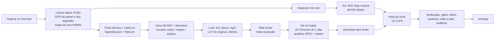

# Produção do vídeo 1 — "¿Qué pasaría si la Tierra girara cada vez más rápido y no pudiera parar?"

Registro integral da produção que deu certo, para repetir nos próximos vídeos do canal What If ES sem redescobrir nada.
Tudo aqui foi executado e conferido em 20–21/10/2026. Os erros que custaram tempo estão em [`../erros-pipeline.md`](../erros-pipeline.md)
(itens 1–58); este documento conta o caminho certo e aponta para eles quando importa.

- **Original:** "What If Earth Spun Faster and Couldn't Stop?" (canal What If Sim, YouTube `cqlHrns32sg`), 7:37, 1080p30, só música, sem narração.
- **Entrega:** `D:\whatif_es\01_spun_faster\entrega\que_pasaria_si_la_tierra_girara_mas_rapido.mp4` (7:37,5 · 1920×1080 · 30 fps · 13.725 quadros · H.264 CRF 21 · AAC · −14,3 LUFS, pico −1,3 dBFS · 599 MB) + `titulo_e_descricao.txt`.
- **Versões anteriores mantidas na mesma pasta:** `_antigo_audio_distorcido.mp4`, `_antigo_com_flicker.mp4`, `_antigo_pipeline_v1.mp4`.
- **Código desta produção (cópia congelada):** [`codigo/`](codigo/) — o projeto vivo fica em `D:\whatif_es`, que não é versionado.

---

## Sumário

1. [Visão geral](#1-visão-geral)
2. [Mapa de pastas](#2-mapa-de-pastas)
3. [Etapa 1 — Leitura do original](#3-etapa-1--leitura-do-original)
4. [Etapa 2 — Versão em espanhol (texto, painel, física)](#4-etapa-2--versão-em-espanhol-texto-painel-física)
5. [Etapa 3 — A cena 3D](#5-etapa-3--a-cena-3d)
6. [Etapa 4 — Look cinematográfico](#6-etapa-4--look-cinematográfico)
7. [Etapa 5 — Teste local](#7-etapa-5--teste-local)
8. [Etapa 6 — Render na G4 (Colab)](#8-etapa-6--render-na-g4-colab)
9. [Etapa 7 — Som](#9-etapa-7--som)
10. [Etapa 8 — Verificação](#10-etapa-8--verificação)
11. [Etapa 9 — Entrega](#11-etapa-9--entrega)
12. [Linha do tempo real desta produção](#12-linha-do-tempo-real-desta-produção)
13. [Regras de ouro (o que não pode faltar)](#13-regras-de-ouro-o-que-não-pode-faltar)
14. [Licenças](#14-licenças)
15. [Checklist do próximo vídeo](#15-checklist-do-próximo-vídeo)
16. [Pendências deste vídeo](#16-pendências-deste-vídeo)
17. [Auditoria do vídeo entregue](#17-auditoria-do-vídeo-entregue)

---

## 1. Visão geral

O canal reproduz, em espanhol e com o máximo de fidelidade, cada vídeo do What If Sim: mesmos capítulos, mesmos tempos, mesma câmera,
mesmo painel e mesma trilha sonora em espírito. Nada é copiado: a cena é refeita em 3D próprio, a música e os efeitos são gerados,
os textos são reescritos em espanhol com unidades métricas.



Divisão de trabalho (regra do canal, ver memória "pesado vai para a G4"): **o PC só orquestra e testa stills**; render, música e
efeitos rodam na **G4 do Colab**; mixagem e verificação rodam no PC porque são leves.

Tempo de máquina deste vídeo na versão final: render de 13.725 quadros em **89 s** + reparo e encode em ~3 min na G4
(pipeline da VM inteira, de `inicio` a `VIDEO1E_PRONTO`: 6 min). Upload do projeto ~5–10 min, download do mp4 ~10 min.

---

## 2. Mapa de pastas

```
D:\whatif_es\
├─ stack\                     package.json + lock do stack comum (node_modules compartilhado por junction)
│  └─ lut_mkl.py              gera as LUTs 3D de cor a partir de quadros nossos × do original
├─ vm_comum\                  scripts que vão para /content/vm_comum na G4
│  ├─ render_seq.sh           render em quadros sem flicker (24 Chromes de 1 aba) + reparo + encode
│  ├─ reparar.py              acha quadro com glitch e re-renderiza com aquecimento
│  └─ producao_v1e.sh         sessão completa da VM para este vídeo (GPU/EGL, apt, texturas, npm ci, render)
├─ auditoria\                 leitura comparativa original × produzido (medir, comparar, folhas, som, comparativo)
├─ g4.py  term.py  espera.py  automação do Colab (ligar, enviar, baixar, desligar, terminal, esperar marcador)
├─ analisar.py                leitura óptica do original (10 fps, OCR, mapa de som)
├─ glitch.py                  varredura de glitch no mp4 final
├─ zipar.py                   empacota arquivos para mandar à VM
└─ 01_spun_faster\
   ├─ FICHA.md                ficha técnica do original (cópia em ./FICHA_original.md)
   ├─ ref\                    original: v.mp4, legendas .vtt, q10\ (quadros a 10 fps), hud_ocr.json, dia_pontos.json, tags.json
   ├─ v2\                     PROJETO DESTA ENTREGA
   │  ├─ src\                 index.tsx, Video.tsx, Cena.tsx, roteiro.ts, fisica.ts, legendas.json, ciclo_original.json
   │  │  ├─ look\             Look.tsx (compositor) + luts.json
   │  │  └─ mundo\            comum.tsx, Costa.tsx, Oregon.tsx, Espaco.tsx, objetos.tsx
   │  ├─ public\              terra_dia.jpg, terra_noite.jpg, lua.jpg, waternormals.jpg
   │  ├─ audio\               mapa.json, mapa_g4.json, gerar_efeitos.py, mixar.py, pacote\ (stems .flac)
   │  ├─ render\              mp4s baixados da G4 e mixados
   │  └─ teste\               stills e folhas de conferência
   └─ entrega\                mp4 final + titulo_e_descricao.txt (+ versões antigas com prefixo _antigo_)
```

No repositório, [`codigo/`](codigo/) tem a cópia de `v2/src`, `package.json`, `remotion.config.ts`, `tsconfig.json`, os scripts de áudio,
`vm_comum`, `auditoria` e as ferramentas. O que **não** foi copiado: `colab.py` (fica em `D:\prehistoria`, tem a parte de navegador),
texturas (baixadas na VM por URL pública), stems de áudio e vídeos.

---

## 3. Etapa 1 — Leitura do original

### 3.1 Baixar
`yt-dlp` do vídeo com legendas em inglês → `ref/v.mp4`, `ref/v.en-orig.vtt`, `ref/v.info.json`. Áudio extraído em 32 kHz e 48 kHz
(`audio32k.wav`, `audio48k.wav`) para o classificador e para referência de nível.

### 3.2 Leitura óptica a 10 fps — `analisar.py`
Rodar dentro de `ref/`: `python -I D:\whatif_es\analisar.py`
- `q10/`: um JPEG 480 px a cada 0,1 s (4.570 quadros neste vídeo).
- Folhas de contato (`geral_*.jpg`: visão do vídeo inteiro; densas por trecho) com o tempo carimbado em cada miniatura.
- OCR das legendas a 1 fps (`ocr.json`) → base de `legendas.json`.
- Mapa de som: PANNs CNN14 a cada 2 s (`tags.json`, `tags_probs.npy`): quando há música, vento, onda, multidão, explosão etc.
- Métricas por segundo (`metricas.json`/`metricas.png`): luminância, saturação, densidade de borda, cortes.

Com isso se escreve a **ficha técnica** (`FICHA.md`): capítulos, câmera de cada um, objetos, ações, painel, ritmo, som.
Regra: a ficha descreve o que **se vê**, quadro a quadro; o roteiro só é escrito depois dela.

### 3.3 Painel por OCR — `ref/ocr_hud.py`
O contador "ONE DAY LASTS" é lido por OCR (rapidocr) a 1 fps no recorte do canto superior esquerdo → `hud_ocr.json`.
Mediana móvel e "nunca crescente" → `dia_pontos.json` → vira a tabela `PONTOS` de `fisica.ts` (segundo do vídeo → minutos do dia),
interpolada em log. Assim o nosso contador bate com o do original em todos os segundos.

### 3.4 Ciclo dia/noite do original — `ciclo_original.json`
Entre 2:33 e 4:53 o original alterna dia e noite. A luminância do original a 10 fps nesse trecho (153–293 s, passo 0,1 s,
1.401 valores normalizados 0..1) foi salva em `ciclo_original.json` e dirige a elevação do sol em `Cena.tsx` (`elevSol`).
Ver a pendência da seção 16: a conversão luminância → sol ainda é tímida na cidade.

### 3.5 Cor do original
Quadros do original e nossos nos mesmos instantes, por mundo (costa, oregon, espaço), alimentam `stack/lut_mkl.py` (seção 6.3).

---

## 4. Etapa 2 — Versão em espanhol (texto, painel, física)

- **Título:** "¿Qué pasaría si la Tierra girara cada vez más rápido y no pudiera parar?" Descrição com capítulos e fontes em
  `titulo_e_descricao.txt` (cópia em [`titulo_e_descricao.txt`](titulo_e_descricao.txt)).
- **Legendas:** `src/legendas.json` — `{s, e, txt}` com os mesmos tempos do original, frase reescrita (não traduzida palavra a palavra).
  Itálico serifado (Source Serif 4 Italic) centralizado embaixo, com halo escuro radial atrás.
- **Painel** (`Video.tsx`, componente `Painel`), canto superior esquerdo, como no original:
  - rótulo `UN DÍA DURA` (IBM Plex Sans 500, espaçado);
  - número grande serifado (`fmtDia`): `23 h 54 min`… e abaixo de 1 h só `N min` (o original nunca mostra segundos);
  - linha 2: peso (`PESAS 78 KG` / `NO PESAS NADA`) na Terra, velocidade do equador (`EL ECUADOR SE MUEVE A 2.406 KM/H`) no espaço;
    em Santa Mónica acrescenta `· EL SUELO SE SIENTE INCLINADO N°`;
  - linha 3: local (`EL ECUADOR`, `CANNON BEACH, OREGÓN`, `SANTA MÓNICA`, `LA TIERRA`, `LA LUNA`…);
  - linha 4 em laranja (`#f2b45a`): comparação de velocidade (`… MÁS RÁPIDO QUE EL SONIDO`, `… QUE UNA BALA DE RIFLE` etc.).
- **Física** (`fisica.ts`, unidades métricas, pessoa de 82 kg):
  - `diaMin(t)`: duração do dia no segundo `t` (tabela do OCR);
  - `fatorPeso(m, lat) = 1 − (1440/m)² × 0,00346 × cos²(lat)` → peso zero com dia de ~84 min no equador;
  - `velEquador(m) = 40.075 / (m/60)` km/h;
  - `gEf(m)`: gravidade efetiva no equador, usada pela fonte e pelos objetos que flutuam;
  - limiares das comparações: Blackbird 3.540 km/h, bala de rifle 4.300 km/h, ISS ~27.600 km/h, escape 40.270 km/h;
  - `inclinacao(m, lat)`: ângulo que o chão "parece" ter em Santa Mónica (componente tangencial da centrífuga);
  - `faseJato(t, v, gMin, vidaMax)`: fase das gotas dos jatos, **integrada** (seção 5.6).
- Telas finais (7:15 em diante): corte seco para fundo `#0b0d12`, textos no **alto** (o terço de baixo fica livre para os cards do YouTube):
  "Empezaste con un día de 24 horas." → "¿Algo de esto es real?" com o parágrafo do que é real e do que não é → "Ahora mira qué pasaría si te volvieras más pesado." + "SUSCRÍBETE…".

---

## 5. Etapa 3 — A cena 3D

### 5.1 Stack (versões travadas no `package.json` + lock)

| Pacote | Versão | Papel |
|---|---|---|
| remotion, @remotion/cli, @remotion/three | 4.0.537 | composição quadro a quadro, render, `ThreeCanvas` |
| @remotion/noise | 4.0.537 | ruído determinístico (tremor de câmera) |
| @remotion/google-fonts | 4.0.537 | IBM Plex Sans, Source Serif 4 (normal e itálico) |
| three | 0.180.0 | 3D |
| @react-three/fiber | 9.8.2 | React para three |
| @react-three/drei | 10.7.9 | utilitários |
| postprocessing | 6.39.5 | efeitos (bloom, AgX, LUT 3D, vinheta…) |
| n8ao | 2.0.1 (via @react-three/postprocessing 3.2.1) | oclusão de ambiente |
| react / react-dom | 19.2.0 | |
| typescript | 5.6.3 | `npx tsc --noEmit -p .` antes de qualquer render |

`node_modules` é um **junction** para `D:\whatif_es\stack\node_modules` (funciona no bundle; symlink em `public/` **não** funciona — erro 44).
`remotion.config.ts`: JPEG 94, H.264 CRF 18 (o encode final sai do `reparar.py` com CRF 21).

### 5.2 Arquitetura

```
index.tsx    Composition "Video" 1920×1080, 30 fps, DURACAO 457,5 s × 30 = 13.725 quadros
└─ Video.tsx         camadas HTML por cima da cena: painel, legendas, título, telas finais, fusões entre capítulos
   └─ Canvas3D       ThreeCanvas (toneMapping NoToneMapping, sRGB, sombras, antialias off — quem faz o look é o compositor)
      └─ Cena.tsx    câmera do capítulo (+ tremor), luz do sol, escolhe o mundo e o perfil de look
         ├─ mundo/Costa.tsx    orla, praia, cidade, calçadão, Santa Mónica, fonte, jatos, paredão
         ├─ mundo/Oregon.tsx   Cannon Beach, Haystack Rock, casa de tijolo, terremoto, poeira
         ├─ mundo/Espaco.tsx   Terra dia/noite, oceanos migrando, achatamento, anel de rochas, crosta derretida, Lua
         ├─ mundo/comum.tsx    céu, sol, nuvens procedurais, mar, luz, texturas de canvas, rnd/smooth
         ├─ mundo/objetos.tsx  pessoas, palmeiras, prédios, itens instanciados, Fonte (partículas)
         └─ look/Look.tsx      compositor de pós-processamento síncrono (seção 6)
```

### 5.3 Determinismo (inegociável)
- Tudo é função de `frame / fps`. **Nada** de `useFrame` com relógio, `Math.random`, `clock.getDelta`, física acumulada.
  O `ThreeCanvas` do Remotion avança com `performance.now()`, então qualquer coisa temporal fora de `t` quebra o render paralelo.
- Aleatoriedade com semente: `rnd(i)` em `comum.tsx`, `noise3D('tx', …)` no tremor, hash `fract(sin(x)…)` nos shaders.
- Cada quadro tem que poder ser renderizado sozinho, por qualquer aba, em qualquer ordem — é isso que permite 24 Chromes em paralelo
  e o reparo de quadros soltos.
- **Fase de qualquer coisa periódica cujo período muda com o tempo = integral, nunca `t / período(t)`** (erro 57, seção 5.6).
- `KHR_parallel_shader_compile` desligado em `Video.tsx` (compilação paralela de shaders dava quadros sem material — erro 40).

### 5.4 Capítulos e câmeras — `roteiro.ts`
Mesmos tempos do original. Câmera por chaves `[fração do capítulo, posição, alvo, rolagem, fov]`, interpoladas por `camDe`.
`entrada` diz como o capítulo entra: `funde` (fusão de 0,6 s com o anterior, `FUSAO = 0.6`), `corte` (seco) ou `continuo` (mesmo plano).

| id | tempo | mundo | câmera (resumo) | entrada |
|---|---|---|---|---|
| intro | 0:00–0:04 | espaço | Terra achatada com anel, aproximação lenta | corte |
| orla | 0:04–0:29 | costa | aérea a ~19 m sobre o calçadão, praça com chafariz, mar no terço de cima | corte |
| praia | 0:29–1:00 | costa | na areia olhando o mar; a água sobe e a câmera sobe junto (y 2 → 4,9) | funde |
| oregon | 1:00–1:33 | oregon | Cannon Beach a 9 m, Haystack Rock e casa | funde |
| espaco1 | 1:33–2:02 | espaço | Terra de perto, oceanos migrando para o equador | funde |
| terremoto | 2:02–2:33 | oregon | trilho para a direita e para baixo, estrada e gente no primeiro plano, tremor | funde |
| cidade | 2:33–3:00 | costa | aérea a ~90 m: prédios, avenida, calçadão, praça, mar | funde |
| leve | 3:00–3:29 | costa | calçadão elevado olhando o mar | funde |
| santamonica | 3:29–3:58 | costa | sobre o tabuleiro do píer com roda-gigante, pan e rolagem −0,16 rad | funde |
| fonte | 3:58–4:23 | costa | baixa (1,7 m), fov 62, inclinando para cima para os 7 jatos | funde |
| sempeso | 4:23–4:53 | costa | de volta à aérea da orla; tudo começa a flutuar | funde |
| paredao | 4:53–5:18 | costa | mesmo plano do sempeso; o paredão chega e engole a câmera (5:12) | continuo |
| achata | 5:18–5:47 | espaço | Terra achatando, ar escapando pelo equador | funde |
| anel | 5:47–6:16 | espaço | anel de rochas arrancadas do equador | funde |
| crosta | 6:16–6:45 | espaço | crosta se abre, lava | funde |
| lua | 6:45–7:15 | espaço | Lua enorme à esquerda, Terra pequena com o disco de perfil | funde |
| fim | 7:15–7:37,5 | texto | telas finais | corte |

### 5.5 Mundos (o que tem em cada um)

**Costa** (`Costa.tsx`, a maior parte do vídeo)
- Mar em shader (`Mar` em `comum.tsx`) com normais `waternormals.jpg`, espuma na linha da praia, nível e agitação parametrizados.
- Praia de areia, calçadão cinza (`#9b9890`) com piso em lajota, praça redonda (`Praca`) com chafariz, bancos, postes com luzes à noite
  (`LuzesPostes`, esferas emissivas sem luz real), guarda-sóis, cadeiras, boias, carros, torre de salva-vidas listrada (`texListras`).
- Multidão instanciada (`MultidaoR`, `gerarPessoas`): cabeças em icosaedro, cabelo em calota, tronco e membros em cilindro
  (proporção humana; os cubos "estilo Minecraft" da primeira versão foram reprovados na auditoria).
- Palmeiras instanciadas (`PalmeirasR`), prédios com janelas por textura de canvas (`Predios`, acendem à noite).
- `longe()` esconde item a menos de 9 m da câmera (evita boneco gigante no primeiro plano).
- Parâmetros por capítulo vindos de `Cena.tsx`: `costa`/`nivel`/`inunda`/`espuma`/`agit` (o mar sobe na praia entre 0:38 e 0:56),
  `cidade`, `pier` (`PierSM`), `desliza` (coisas escorregando para o equador em Santa Mónica), `flutua` (sempeso/paredão),
  `paredao` (0..1), `praca`, `jatos` (`JatosFila`, 7 jatos no capítulo fonte), `jatoAlto` (`JatoAlto`, sempeso e paredão), `semFonte`.
- **Paredão** (`Paredao`): plano curvo de 2.400 m, shader com corpo verde-azulado escuro com estrias verticais, crista branca
  com ruído e névoa na base; `z = −520 + p×540`, `altura = 30 + p×62` para a crista ficar no terço de cima com céu acima (erro 58).
  Quando ele chega (5:11,5–5:13) entra por cima uma camada HTML azulada "dentro d'água" (`Video.tsx`).

**Oregon** (`Oregon.tsx`)
- Haystack Rock: domo facetado `rocha(38, 64, 3, 4, 0.06)`, casa de tijolo, estrada com faixa amarela, gente andando.
- Céu nublado (`nublado 0.75`), nuvens mais baixas, névoa, poeira (80 sprites a 0,3 de opacidade derivando para a esquerda).
- Terremoto: tremor de câmera (`tremer`, `noise3D` a 9 Hz, amplitude 0,32) e tremor da cena, casa desmoronando, poeira.

**Espaço** (`Espaco.tsx`)
- Terra com `terra_dia.jpg` (NASA Blue Marble) e `terra_noite.jpg` (NASA Black Marble) num shader só: terminador, luzes das cidades,
  oceanos deixando os polos e se acumulando no equador (`uMigr`), achatamento, névoa de ar escapando pelo equador (faixa clara — é proposital).
- Anel: 16.000 rochas instanciadas, raio `1,12 + rnd^0,8 × 2,9`, bege com tom de lava. Crosta derretida laranja-amarela com manchas marrons.
- Lua (`lua.jpg`) em (−2,75, −0,15, 3,65), raio 0,95. Nebulosa cinza a 0,03. Luz direcional 3,2.
- Fundo quase preto: a auditoria mostrou que o nosso azul-marinho saturado era o maior desvio de cor.

### 5.6 Fonte e jatos — partículas sem estado
Cada gota é função pura do tempo: posição = bocal + velocidade × idade − ½ g × idade², com `idade = fract(fase + semente) × vida`.
A **fase** vem de `faseJato` (`fisica.ts`): `F(t) = Σ dt / vida(t)` com `vida = min(2v/g, vidaMax)` e `g = gEf(diaMin(t))`,
pré-calculada a 1/30 s e cacheada. No shader: `idade = fract(uF × uV0 / v + h(s)) × vida`.
Antes era `fract(uT / vida)`: com a gravidade caindo, a vida mudava a cada quadro e a 244 s as gotas andavam **para trás a 7×**
(erro 57). Medido: passo de fase por quadro antigo −0,0303, novo +0,0044.

### 5.7 Luz e dia/noite
`luzDe(elevação, …)` em `comum.tsx` dá cor do céu, sol, luz hemisférica e direcional. `elevSol(t, capId)` em `Cena.tsx`:
dia fixo antes de 2:33 e em Santa Mónica/paredão; entre 2:33 e 4:53 vem de `ciclo_original.json` (`asin(2d−1) × 0,55`);
cidade fixa em 0,75 nesta entrega (ver seção 16).

### 5.8 Composição final (`Video.tsx`)
- Canvas do capítulo atual; durante os 0,6 s de fusão, um segundo `Canvas3D` com o capítulo anterior por cima, opacidade 1 → 0.
  (Só nesse trecho existem dois canvases; o resto do tempo é um só.)
- Vinheta radial escura atrás do painel (`rgba(6,9,15,.55)` em 14% 14%) para o painel não sumir em céu claro.
- 0:00,4–0:03,9 "En 7 minutos, esto es la Tierra."; título 0:04,4–0:07,9 a 45% da altura.
- Telas finais com corte seco em 7:15 e textos no alto.

---

## 6. Etapa 4 — Look cinematográfico

### 6.1 Compositor próprio, síncrono — `look/Look.tsx`
O `EffectComposer` do `@react-three/postprocessing` monta de forma assíncrona e o **primeiro quadro de cada aba saía preto** (erro 50).
Então o `Look` monta um `EffectComposer` do `postprocessing` dentro de `useMemo` e desenha em `useFrame(…, 1)` (prioridade 1 tira o
desenho automático do R3F). Ordem dos passes:

1. `RenderPass(scene, camera)`
2. `N8AOPostPass` (só nos perfis com `ao`; raio 3, falloff 1,2, intensidade 1,6, meia resolução, qualidade Medium)
3. **Saneamento** (`ShaderPass`): NaN → preto, `clamp(0, 32)` — **obrigatório antes do bloom** (erro 53)
4. `EffectPass` com: `BloomEffect` (mipmapBlur, limiar `perfil.limiar ?? 0.9`, suavização 0,2, raio 0,72) → `ToneMappingEffect` AgX →
   `LUT3DEffect` (LUT do original) → `HueSaturationEffect` → `BrightnessContrastEffect` (contraste 0,04) → `VignetteEffect` (offset 0,32)

Buffer `HalfFloatType` com MSAA 4 na GPU. Se o renderer for por software (SwiftShader/llvmpipe, lido de `WEBGL_debug_renderer_info`),
usa `UnsignedByteType`, sem MSAA e sem AO, e escreve `LOOK_SOFTWARE` no console (erro 52) — o `render_seq` confere que nenhuma parte caiu nisso.

### 6.2 Perfis por mundo (`Cena.tsx`, `PERFIS`)

| mundo | AO | bloom | limiar | saturação | vinheta | LUT |
|---|---|---|---|---|---|---|
| costa | sim | 0,5 | 0,9 | 0,0 | 0,42 | `costa` |
| oregon | sim | 0,35 | 0,9 | −0,05 | 0,42 | `oregon` |
| espaço | não | 0,45 | 0,9 | −0,1 | 0,5 | `espaco` |

### 6.3 LUT do original — `stack/lut_mkl.py`
Transferência de cor Monge-Kantorovich linear (Pitié 2007) dos **nossos** quadros para os **do original**, por mundo:
`python lut_mkl.py <pasta com pNNN.png e oNNN.png> look/luts.json costa=f1,f2,… oregon=… espaco=…`
- amostra em 480×270, **painel (canto superior esquerdo) e faixa da legenda fora da estatística**;
- LUT 17³, força 0,85 (mistura com a identidade), saída em `luts.json` (vira `Data3DTexture` 8 bits em `lutTextura`).
- Refazer a LUT sempre que a cena mudar muito de cor (ela corrige o que existe, não o que vai existir).

### 6.4 Shaders próprios sob o compositor
Os `ShaderMaterial` próprios (céu, nuvens, mar, paredão, gotas) escreviam cor já em sRGB; pelo compositor o buffer é linear e tudo
saía lavado (o paredão sumia — erro 51). Regra: **todo shader próprio termina com**
`gl_FragColor.rgb = pow(max(gl_FragColor.rgb, vec3(0.0)), vec3(2.2));`

### 6.5 Chaves de depuração
`--props='{"dbg":"semBloom"}'` (ou `semAO`, `semFonte`, `fb8`, combináveis por vírgula) liga e desliga partes do look e da cena
sem mexer no código (`globalThis.__dbg`, lido em `Video.tsx`). Foi assim que se achou o bloom espalhando NaN: um still por chave
**na G4**, brilho médio de cada um — `nada 1,7 · semAO 1,7 · semFonte 1,7 · semBloom 136 · fb8 139`.

---

## 7. Etapa 5 — Teste local

- Checagem de tipos: `npx tsc --noEmit -p .` (na pasta `v2`).
- Still em meia resolução: `npx remotion still src/index.tsx Video teste/st/<q>.png --frame=<q> --scale=0.5`
  (vários em paralelo com `&` e `wait`). Sequência curta: `npx remotion render src/index.tsx Video teste/seq --sequence --frames=a-b --scale=0.5 --image-format=jpeg`.
- `src/teste_flags.ts` (só local, importado por `index.tsx`; **removido** do pacote da VM): `__fb8`, `__semAO` para o Chrome local.
- O Chrome local é SwiftShader: serve para composição, câmera, cor geral e texto. **Não** serve para validar o look HDR
  (HalfFloat, bloom, AO) — isso só se valida com stills **na G4** antes do render longo (erro 53).
- Montagem para olhar: `ffmpeg … -filter_complex "[0][1]hstack[a];[2][3]hstack[b];[a][b]vstack"` e ler a imagem.
- Sempre comparar com o quadro do original no mesmo segundo (`ffmpeg -ss <t> -i ref/v.mp4 -frames:v 1`).

---

## 8. Etapa 6 — Render na G4 (Colab)

### 8.1 Como o PC fala com o Colab
- O notebook roda num perfil do **Dolphin Anty** (navegador com perfil próprio), controlado por Playwright via CDP.
  Se o navegador travar: parar e iniciar o perfil pela API local do Dolphin (`/v1.0/browser_profiles/<id>/stop` e `…/start?automation=1`
  em `localhost:3001`), esperar ~20 s se responder `PROFILE_ALREADY_RUNNING`.
- `D:\prehistoria\colab.py` (não versionado aqui): achar a aba, limpar células, rodar célula e esperar marcador, conectar, desligar, baixar, `VIGIA`.
- **Nunca** colar cookies nem digitar senha; avisos de termos/privacidade do Colab: recusar ("Cancelar").

### 8.2 Comandos (`g4.py`, `term.py`, `espera.py`) — sempre com `MSYS_NO_PATHCONV=1` no Git Bash

| Comando | O que faz |
|---|---|
| `python g4.py ligar` | limpa as células, clica em Conectar (G4), sobe o **vigia** (desliga a VM depois de 20 min ociosa) |
| `python g4.py enviar <zip> <pasta>` | pacote pequeno numa célula (base64 → zip → extrai) |
| `PEDACO=15000 python g4.py enviar_grande <zip> <pasta>` | pacote grande em pedaços; cada pedaço num arquivo próprio (`/content/_up_NNN.b64`, aberto com `'w'`), depois junta e extrai. **15.000 caracteres**: com 45.000 o CDP do Dolphin caía (`Keyboard.insert_text: Connection closed`) |
| `python term.py "<cmd>" [espera_s]` | digita no terminal da VM (independe do kernel); usar para disparar com `setsid nohup … &` |
| `python espera.py <arquivo_status> <marcador> [max_min]` | espera o marcador aparecer no arquivo de status da VM |
| `python g4.py baixar <remoto> <local>` | limpa as células e baixa pelo navegador (conferir nº de quadros depois — erro 43) |
| `python g4.py desligar` | desconecta e exclui o runtime; imprime `G4 desligada (verificado)` e `conectado depois: False` |

### 8.3 Pacotes
- `pkg_comum.zip` → `/content`: `vm_comum/` (`render_seq.sh`, `reparar.py`, `producao_v1e.sh`).
- `pkg_v1e.zip` (156 KB) → `/content/v1b`: `src/` (sem `teste_flags.ts` e sem o import dele), `package.json`, `package-lock.json`,
  `remotion.config.ts`, `tsconfig.json`. Montado em pasta temporária com `zipar.py`.
- A VM é **apagada** a cada desligamento: sempre reenviar `vm_comum` e o projeto.

### 8.4 Sessão da VM — `vm_comum/producao_v1e.sh`
Disparo: `python term.py "setsid nohup bash /content/vm_comum/producao_v1e.sh > /content/prod_v1e.out 2>&1 < /dev/null & …"`
e esperar `FIM` em `/content/status_v1b.txt`.
1. GPU no Chrome headless: `LD_LIBRARY_PATH=/usr/lib64-nvidia`, ICD EGL da NVIDIA em `/usr/share/glvnd/egl_vendor.d/10_nvidia.json`,
   remove o `50_mesa.json`.
2. `apt-get install` das bibliotecas do Chrome (libnss3, libgbm1, libasound2t64…).
3. Texturas por URL pública (`wget`): NASA Blue Marble e Black Marble, `waternormals.jpg` e `moon_1024.jpg` do repositório do three.js.
   Copiadas, nunca symlink (erro 44).
4. `npm ci` com o lock.
5. `render_seq.sh /content/v1b 13725 VIDEO1E`.

### 8.5 Render sem flicker — `vm_comum/render_seq.sh` + `reparar.py`
- `npx remotion bundle` uma vez; depois **P = 24 processos** `npx remotion render bundle Video frames/pNN --sequence --frames=S-E`
  (`--image-format=jpeg --jpeg-quality=94 --gl=angle-egl --chrome-mode=chrome-for-testing --concurrency=1 --timeout=240000 --log=verbose`),
  cada um um Chrome com **uma aba**, partidas espaçadas de 2 s (todos juntos disputavam a GPU e alguns caíam para software).
- `reparar.py`: nota de glitch por quadro (miniatura 192×108 cinza, painel e legenda mascarados; pixels que diferem dos **dois** vizinhos
  enquanto os vizinhos são parecidos entre si, limiar > 150); cada suspeito é re-renderizado **com 3 quadros de aquecimento antes**
  e fica a versão de nota menor (erros 40–42). Suspeito que volta com a mesma nota é movimento legítimo e determinístico (as gotas).
- Encode: `ffmpeg -framerate 30 -i seq/%05d.jpeg -c:v libx264 -crf 21 -preset medium -pix_fmt yuv420p` → `out/video_crf.mp4`.
- Conferências na VM depois do render: `grep -l LOOK_SOFTWARE out/*.log | wc -l` tem que dar **0**; `quadros_89s 13725`;
  `trocados 0 de 455` nesta entrega.

### 8.6 Desligar
Assim que o mp4 (e qualquer pacote de áudio) estiver baixado e com o nº de quadros conferido: `python g4.py desligar` e ler
`G4 desligada (verificado)`. G4 parada cobra; o vigia é só rede de segurança.

---

## 9. Etapa 7 — Som

### 9.1 Mapa de som — `audio/mapa.json`
Feito a partir do mapa PANNs do original e da escuta por capítulo. Cada camada com trecho e **nível alvo em LUFS**.
- **Música (ACE-Step 1.5, instrumental, sem voz)**: 12 cues curtas, uma por bloco do vídeo — m01 0–7 s (−24), m02 56–93 (−33),
  m03 93–122 (−21), m04 122–153 (−34), m05 153–209 (−20), m06 209–263 (−21), m07 263–293 (−20), m08 293–318 (−27), m09 318–376 (−19),
  m10 376–405 (−21), m11 405–435 (−20), m12 437–457,5 (−30). Cada uma com `caption` em inglês descrevendo clima e instrumentação.
- **Efeitos (MOSS-SoundEffect v2.0)**: s01 praia movimentada 4–44 (−17), s02 água subindo 40–56 (−18), s03 vento forte na costa
  60–93 (−21), s04 terremoto 122–152 (−11), s09 coisas deslizando 222–238 (−29), s10 fonte 240–263 (−28), s11 vento estranho e
  objetos flutuando 263–293 (−32), s12 tsunami chegando 299–314 (−13), s14 subaquático abafado 313–318 (−20), s13 rumor tectônico e lava 378–399 (−15).
- **Silêncio** `[434,5, 437,0]`: o original corta o som antes das telas finais.
- `mapa_g4.json`: só o que precisa ser gerado naquela sessão (aqui s03 e s14, novos desta versão).

### 9.2 Geração na G4
- Música: `audio/gerar_musica.py` no ambiente do ACE-Step 1.5 (`uv sync` no repositório clonado; DiT `acestep-v15-xl-sft` + LM 4B em vLLM,
  com recuo para turbo + LM 1.7B); 2 sementes por cue, fica a com menos chiado (planura espectral 4–14 kHz).
- Efeitos: `audio/gerar_efeitos.py` num venv próprio (`uv venv -p 3.12`, torch 2.9.0 cu128, transformers 4.57.1, diffusers 0.37.1…;
  `uv pip install --python <venv>/bin/python` — erro 37); trechos > 30 s viram 2+ gerações de até 30 s encadeadas;
  100 passos, cfg 4,0, sigma_shift 5,0, semente 100+k. Grava com `soundfile` (erro 38). `TORCHDYNAMO_DISABLE=1`.
- Cada etapa converte para FLAC, empacota (`musica.tar`, `efeitos.tar`) e escreve `MUSICA_PRONTA`/`EFEITOS_PRONTOS` **assim que termina**,
  para baixar na hora (erro 39). `audio/audio_vm.sh` roda as duas em paralelo.
- Os stems ficam em `v2/audio/pacote/` como `mNN.flac` e `sNN_K.flac`.

### 9.3 Mixagem local — `audio/mixar.py`
`python mixar.py <video_mudo.mp4> <saida.mp4>`
1. Cada música no seu trecho (+1,5 s de cauda), normalizada ao LUFS alvo (pyloudnorm), fade-in 1,5 s / fade-out 2,5 s;
   repete com crossfade de 1,5 s se a cue for curta.
2. Cada efeito: partes encadeadas com crossfade, LUFS alvo, fade-in 2 s (0,4 s nos impactos s04, s12, s14), fade-out 2,5 s.
3. Janelas de silêncio com rampas de 80 ms (sem estalo).
4. Limitador suave + `loudnorm` em **duas passadas** (medição e aplicação linear): **−14 LUFS, −1,5 dBTP, LRA 11**.
5. Mux com o vídeo **copiado** (sem re-encode). Saída desta entrega: `MIX_OK -16.35 -> -14`; medido no mp4: I −14,3 LUFS, pico −1,3 dBFS.

---

## 10. Etapa 8 — Verificação

Nada é entregue sem passar por todas estas, nesta ordem:

1. **Nº de quadros** do mp4 baixado: `ffprobe -count_packets -select_streams v -show_entries stream=nb_read_packets` = 13.725.
2. **Quadros pretos / escuros**: brilho médio a 2 fps (fora do painel) < 12 → listar e olhar. Aqui só 93,5–94 e 99,5–100 s:
   tomadas do espaço, escuras também no original.
3. **Glitch**: `python glitch.py <mp4>` — quadros soltos que diferem dos dois vizinhos. Sequência contínua de suspeitos é movimento
   (aqui 125, todos no trecho dos jatos 4:00–4:12); quadro isolado é glitch e se troca (erro 46).
4. **Loudness**: `ffmpeg -i <mp4> -af ebur128=peak=true -f null -` → I ≈ −14 LUFS, pico < −1 dBFS.
5. **Folha de contato a cada 8 s**, nossa e do original (`fps=1/8,scale=320:180,tile=8x7`), lidas lado a lado.
   Foi aqui que apareceram a cidade de noite e o paredão que parecia céu.
6. **Lado a lado nos pontos críticos** (quadro nosso | quadro do original no mesmo segundo).
7. **Coerência temporal** de partículas: diferença entre quadros k→k+1 e k→k+2 e a fase por quadro calculada fora do render
   (foi como se provou que as gotas andavam para trás).
8. **Auditoria comparativa a 10 fps** (`auditoria/`): `medir.py` (métricas por quadro: luminância, saturação, cor, borda, cortes por
   Bhattacharyya, fluxo óptico Farneback), `comparar.py` (tabela por capítulo e gráficos), `folhas.py`, `som.py` (PANNs original × nosso),
   `comparativo.sh` (vídeo lado a lado 960×540 cada, tempo carimbado, áudio L = original / R = nosso). Resultado na seção 12.4.

---

## 11. Etapa 9 — Entrega

- Pasta `entrega/`: o mp4 com nome em espanhol sem acento (`que_pasaria_si_la_tierra_girara_mas_rapido.mp4`) e `titulo_e_descricao.txt`
  (título, descrição com os números reais e o que é inventado, capítulos).
- Versão anterior **renomeada** com prefixo `_antigo_<motivo>.mp4`, nunca apagada.
- Lições novas vão para `docs/whatif-es/erros-pipeline.md` e a memória do canal é atualizada.
- G4 desligada e conferida antes de avisar que acabou.

---

## 12. Linha do tempo real desta produção

### 12.1 Versões
| Versão | O que era | Por que foi trocada |
|---|---|---|
| v1 (20/10) | primeira produção, render com várias abas por Chrome | flicker (céu preto, bonecos brancos em quadros soltos) e áudio distorcido |
| v1 sem flicker (21/10 madrugada) | render em quadros com 1 aba por Chrome + reparo | auditoria comparativa mostrou desvios de transição, cor, personagens, dia/noite, painel |
| VIDEO1B/1C (21/10) | pipeline nova (look, LUT, fusões, câmeras novas) | capítulos da costa saíam **pretos na G4** (bloom espalhando NaN do buffer HalfFloat) |
| VIDEO1D (21/10) | saneamento antes do bloom | gotas andando para trás, cidade sempre de noite, paredão invisível |
| **VIDEO1E (21/10) — entregue** | fase integrada, cidade de dia, paredão com crista | — |

### 12.2 O que a pipeline nova mudou em relação à v1 (vindo da auditoria)
- Fusão de 0,6 s entre capítulos (antes: mergulho no preto + corte), corte seco só onde o original corta, sempeso → paredão contínuo.
- Câmeras redesenhadas capítulo a capítulo a partir das folhas de 10 fps (orla a 19 m, praia na areia subindo com a água, cidade a 90 m,
  Santa Mónica sobre o píer com rolagem, fonte de baixo com fov 62, Lua em primeiro plano).
- Pessoas com proporção humana; nada gigante a menos de 9 m da câmera.
- Look: AO + bloom + AgX + LUT MKL do original + saturação por mundo + vinheta; fundo do espaço quase preto.
- Céu com névoa e nuvens procedurais (`texNuvem`, substituiu um PNG sem licença clara), Oregon nublado com poeira.
- Painel com vinheta atrás, legendas em itálico com halo, título a 45%, telas finais no alto.
- Dia/noite a partir da luminância do original; som em camadas com vento (s03) e subaquático (s14) novos e o silêncio antes do fim.

### 12.3 Depuração que valeu registrar
- **Costa preta na G4**: painel visível, cena preta só nos capítulos com a praça; praia, Oregon e espaço normais; 0 partes em software.
  Isolado com stills por chave `dbg` na G4 → o bloom; correção: passe de saneamento antes dele. Stills de 6 capítulos conferidos antes do render longo.
- **"Glitches" contínuos em 4:00–4:12**: não era glitch de render; a fórmula da fase das gotas estava errada (seção 5.6).
- **Upload travando**: pedaços de 45 mil caracteres derrubavam o CDP; 15 mil passou.

### 12.4 Auditoria comparativa antes × depois
Cortes 135 → 37 (original 33), saturação 151 → 81 (original 85), detalhe 10,5% → 14,2% (original 14,5%), paleta 0,64 → 0,78.
Tabelas completas na [seção 17](#17-auditoria-do-vídeo-entregue).

---

## 13. Regras de ouro (o que não pode faltar)

1. Ficha técnica do original **antes** do roteiro; tempos do roteiro = tempos do original.
2. Tudo determinístico em função do quadro; período variável → fase integrada.
3. Shaders próprios terminam linearizando (`pow 2.2`); saneamento NaN/Inf antes do bloom.
4. Look validado com stills **na G4** (cada mundo) antes do render longo; o Chrome local não serve para HDR.
5. Render em quadros, 1 aba por Chrome, partida escalonada, reparo com aquecimento, `LOOK_SOFTWARE` = 0.
6. Conferir nº de quadros de tudo que é baixado.
7. Som com nível alvo por camada e loudnorm em duas passadas a −14 LUFS; silêncios do original respeitados.
8. Verificação completa (seção 10), incluindo **folha de contato lado a lado com o original** — é ela que pega erro de conteúdo.
9. G4 desligada e conferida ao fim de cada sessão.
10. Repo público: nada de e-mail, senha, cookie, token ou ID de perfil em commit.

---

## 14. Licenças

| Item | Fonte | Licença |
|---|---|---|
| Texturas da Terra | NASA Blue Marble / Black Marble | domínio público (NASA) |
| `waternormals.jpg`, `moon_1024.jpg` | exemplos do three.js | MIT |
| Fontes | IBM Plex Sans, Source Serif 4 (Google Fonts) | SIL OFL |
| Música | gerada com ACE-Step 1.5 | Apache 2.0 (modelo); saída nossa |
| Efeitos | gerados com MOSS-SoundEffect v2.0 | Apache 2.0 (modelo); saída nossa |
| Nuvens | procedurais (`texNuvem` em `comum.tsx`) | código nosso |
| Bibliotecas JS | three, R3F, drei, postprocessing, n8ao, Remotion | MIT (Remotion: licença da empresa conforme porte) |

Canal monetizado: só entram modelos e assets com uso comercial liberado.

---

## 15. Checklist do próximo vídeo

- [ ] Baixar o original (`ref/v.mp4` + legendas) e rodar `analisar.py`; OCR do painel (`ocr_hud.py`) se houver contador.
- [ ] Escrever `FICHA.md` (capítulos, câmera, objetos, ações, painel, som) lendo as folhas a 10 fps.
- [ ] `roteiro.ts` com os tempos do original e `entrada` de cada capítulo; `legendas.json`; `fisica.ts` se houver números.
- [ ] Copiar a pasta `v2` deste vídeo como base (look, compositor, scripts de VM, mixagem) e trocar os mundos.
- [ ] `ciclo_original.json` se houver dia/noite; conferir a conversão luminância → sol contra o original.
- [ ] Stills locais em meia resolução de cada capítulo; LUT MKL por mundo.
- [ ] G4: ligar (vigia) → `pkg_comum` → projeto com `enviar_grande` (`PEDACO=15000`) → stills de cada mundo na G4 → `producao_*.sh`.
- [ ] Áudio: `mapa.json` → música e efeitos na G4 (baixar cada pacote assim que sair).
- [ ] Baixar e conferir quadros → **desligar a G4** → `mixar.py`.
- [ ] Verificação da seção 10 inteira, folha de contato lado a lado incluída.
- [ ] Entrega com título e descrição; versão anterior com prefixo `_antigo_`.
- [ ] Erros novos em `erros-pipeline.md`; memória do canal atualizada.

---

## 16. Pendências deste vídeo

- **Dia/noite da cidade (2:33–3:00)**: no original dia e noite alternam a cada ~3 s ("do nascer ao pôr do sol, menos de 3 horas").
  Nesta entrega a cidade está fixa de dia; na VIDEO1D estava sempre no crepúsculo/noite porque `asin(2d−1) × 0,55` dá sol baixo demais
  para luminância ~0,6 (que no original já é dia pleno). Correção proposta: mapear a luminância com rampa mais agressiva
  (ex.: `mix(−0,35, 0,9, smoothstep(0,08, 0,5, d))`) para todo o trecho 153–293 s e tirar o fixo da cidade; vale também para fonte
  (4:04 é pôr do sol no original, no nosso está noite).
- Objetos flutuantes do paredão (quiosque, carros) são caixas lisas; o original tem a mesma ideia com mais detalhe.
- Vídeos 2–4 ainda estão na pipeline antiga; aplicar este documento a eles.

---

## 17. Auditoria do vídeo entregue

Gerada por `auditoria/medir.py` + `comparar.py` sobre o mp4 entregue (leitura a 10 fps, painel e legenda mascarados).
Arquivos: [`auditoria_entrega/capitulos.md`](auditoria_entrega/capitulos.md) e [`auditoria_entrega/graficos.png`](auditoria_entrega/graficos.png).
A auditoria da v1 está em `../auditoria/01_spun_faster/`.

### Vídeo inteiro: v1 × entregue × original

| Métrica | Original | v1 (sem flicker) | **Entregue (VIDEO1E)** |
|---|---|---|---|
| Cortes detectados | 33 | 135 | **37** |
| Movimento médio | 0,25 | 0,27 | **0,25** |
| Detalhe médio (borda) | 14,5% | 10,5% | **14,2%** |
| Saturação média | 85 | 151 | **81** |
| Semelhança de paleta (0–1) | — | 0,64 | **0,78** |
| Semelhança de composição (−1..1) | — | 0,36 | **0,46** |

Leitura:
- **Cortes 135 → 37**: o dia/noite piscando quadro a quadro e os mergulhos no preto sumiram; sobram as fusões e os cortes do próprio original.
- **Saturação 151 → 81** (original 85) e **paleta 0,64 → 0,78**: efeito da LUT MKL, do perfil por mundo e do fundo quase preto no espaço
  (espaço: 211–239 → 57–85, original 26–120).
- **Detalhe 10,5% → 14,2%**: praça, multidão, nuvens, poeira e texturas novas.
- Desvios que ainda aparecem na tabela: cidade mais clara que o original (luz 102 × 62 — é a pendência do dia/noite);
  fonte com movimento 0,99 × 0,50 (gotas mais densas e mais perto da câmera); praia com zoom maior (a câmera sobe com a água);
  Lua mais clara (43 × 21).

### Por capítulo (O = original, P = produzido)

| cap | s–e | cortes O/P | movimento O/P | pan O/P | zoom O/P | luz O/P | saturação O/P | detalhe % O/P | paleta | composição |
|---|---|---|---|---|---|---|---|---|---|---|
| intro | 0–4 | 0/0 | 0.24/0.22 | -0.00/-0.00 | 0.021/0.054 | 38/32 | 51/65 | 24.2/24.7 | 0.80 | 0.60 |
| orla | 4–29 | 1/1 | 0.16/0.05 | 0.09/-0.01 | -0.012/0.014 | 142/135 | 73/66 | 19.0/20.0 | 0.72 | 0.19 |
| praia | 29–60 | 0/0 | 0.24/0.48 | 0.11/-0.07 | 0.018/0.141 | 121/145 | 101/72 | 16.7/11.7 | 0.93 | 0.35 |
| oregon | 60–93 | 0/1 | 0.12/0.06 | 0.03/-0.01 | 0.010/0.018 | 131/133 | 44/52 | 9.4/5.9 | 0.79 | 0.62 |
| espaco1 | 93–122 | 1/1 | 0.07/0.05 | 0.00/0.00 | -0.003/-0.003 | 17/12 | 89/85 | 3.2/2.7 | 0.73 | 0.73 |
| terremoto | 122–153 | 1/2 | 0.56/0.28 | -0.07/-0.02 | -0.001/0.013 | 111/124 | 52/46 | 8.7/5.1 | 0.64 | 0.74 |
| cidade | 153–180 | 0/0 | 0.28/0.05 | -0.03/0.02 | 0.023/0.012 | 62/102 | 152/144 | 10.8/12.8 | 0.66 | 0.43 |
| leve | 180–209 | 15/16 | 0.30/0.17 | 0.05/-0.05 | 0.037/0.007 | 107/107 | 105/100 | 16.3/13.8 | 0.79 | 0.31 |
| santamonica | 209–238 | 0/0 | 0.33/0.06 | -0.27/0.01 | -0.041/-0.021 | 127/126 | 56/67 | 17.9/19.1 | 0.76 | 0.17 |
| fonte | 238–263 | 10/10 | 0.50/0.99 | -0.05/0.05 | 0.086/0.213 | 103/117 | 118/72 | 18.1/20.2 | 0.89 | 0.49 |
| sempeso | 263–293 | 2/3 | 0.13/0.07 | -0.00/0.00 | -0.017/-0.001 | 113/102 | 89/109 | 22.2/17.5 | 0.82 | 0.31 |
| paredao | 293–318 | 1/0 | 0.33/0.34 | -0.04/0.03 | 0.097/0.057 | 115/113 | 89/121 | 17.4/13.9 | 0.84 | -0.06 |
| achata | 318–347 | 1/2 | 0.31/0.51 | 0.00/-0.01 | 0.023/0.086 | 25/32 | 78/78 | 10.4/14.0 | 0.65 | 0.50 |
| anel | 347–376 | 0/0 | 0.22/0.22 | -0.00/-0.01 | 0.016/-0.009 | 38/31 | 51/57 | 22.5/24.2 | 0.92 | 0.64 |
| crosta | 376–405 | 0/0 | 0.46/0.43 | -0.00/-0.00 | 0.019/0.010 | 39/50 | 120/93 | 23.4/24.9 | 0.89 | 0.80 |
| lua | 405–435 | 0/0 | 0.04/0.17 | -0.00/-0.00 | -0.012/-0.034 | 21/43 | 26/31 | 3.2/9.4 | 0.46 | 0.47 |
| fim | 435–457 | 1/1 | 0.02/0.03 | 0.00/-0.00 | -0.005/-0.010 | 8/12 | 150/126 | 2.4/1.7 | 1.00 | 0.48 |

Cortes no vídeo inteiro: original 33, produzido 37. Movimento médio O/P: 0.25/0.25. Detalhe médio O/P: 14.5%/14.2%. Saturação O/P: 85/81. Paleta média 0.78. Composição média 0.46.
