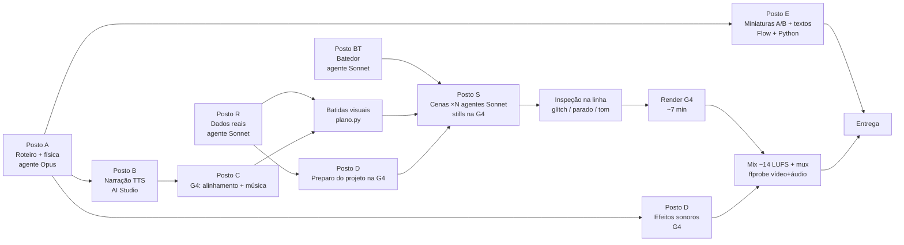

# Tracer3D — mapa completo da pipeline (esteira de produção)

Documento de referência para **qualquer agente** que for produzir ou manter vídeos Tracer3D (explicador narrado com simulação
3D, dados reais e cartões "DIE MATHEMATIK"). Escrito em 23/10/2026 a partir de dois vídeos reais do canal alemão KriegsChronik:
**#1 Das Paris-Geschütz** (publicado) e **#2 Die Dicke Bertha** (em produção). Leia junto com [README.md](README.md) (princípios)
e o [Eddie3D](../eddie3d/README.md) (de onde vêm a stack e as ferramentas da G4).

---

## 1. A esteira em uma figura

**Caminho crítico** (só ele determina o prazo): roteiro → narração → alinhamento → batidas → cenas → render → mix.
Todo o resto (dados, batedor, efeitos, preparo da G4, miniaturas, textos) tem de correr **em paralelo, fora do caminho crítico**.

---

## 2. Os postos (quem faz o quê, com quê, em quanto tempo)

| Posto | Entrada | Saída | Ferramenta / modelo | Tempo medido |
|---|---|---|---|---|
| **A · Roteiro + física** | tema do radar | `roteiro/fakten.md` (2 fontes por fato), `roteiro/skript_de.json` (capítulos, **só texto**), `fisica/fisica.py` → `zahlen.json`, `bahn.json`, `formeln.md` | agente **Opus** (fatos, física e alemão natural pesam na qualidade) | 25–35 min |
| **R · Dados reais** | região do vídeo | `geo/` relevo Copernicus (16 bit + RG 8 bit), satélite EOX **2017** (CC BY), ortofoto oficial se houver licença, OSM, geojson de lugares, fotos CC0/PD, `manifest.json`, `CREDITOS.md` | agente **Sonnet** + scripts `geo_scripts/` | 35–50 min |
| **BT · Batedor** | elementos novos do vídeo | `BATEDOR_<video>.md`: tabela elemento → candidato → licença → custo → ganho → decisão | agente **Sonnet** — **nunca pular**, mesmo com stack pronta (só fica mais curto) | 10–50 min |
| **B · Narração** | `skript_de.json` | `voz/<capitulo>.wav` | Gemini TTS no **AI Studio** (voz "Riko" + estilo de narrador documental), `voz/narrar.py` | ~15 min (11 capítulos) |
| **C · Alinhamento + música** | wavs | `voz/alinhamento.json` (palavra a palavra + transcrição para conferir), `audio/musica.tar` (1 faixa por capítulo, ACE-Step) | **G4** (`alinhar.py` stable-ts large-v3, `gerar_musica.py`) | ~6 min na G4 |
| **D · Efeitos + preparo** | lista de efeitos; esqueleto do projeto | `audio/efeitos.tar` (MOSS); projeto instalado na VM (`/content/kc/v1`) | **G4** (`gerar_efeitos.py`, `preparar_kc.sh`) | ~5–10 min |
| **P · Batidas visuais** | `alinhamento.json` + `skript_de.json` | `v1/src/plano.json`: capítulos e palavras em tempo absoluto + **batidas** (id, s, e, dono, descrição) | `ferramentas/plano.py` — as descrições de cena são escritas **depois** da narração alinhada (no vídeo 1 elas vieram antes e ficaram defasadas) | minutos |
| **S · Cenas** | plano + módulos + dados | `src/beats/<DONO>.tsx` + módulos `welt/ karten/ ui/` | **N agentes Sonnet** em paralelo, um por "dono" (G globo/atmosfera, T terreno/máquina, P cidade, K mapas 2D, U cartões), stills **na G4** | 1–1,5 h (meta) |
| **Q · Inspeção na linha** | stills e render | lista de defeitos por dono | varredura de glitch, trechos parados > 4 s, ✓/glifos, z-fighting, tom (sem gore, sem símbolos) | contínua |
| **Render** | projeto completo | `render/RENDER_MUDO_..._NAO_PUBLICAR.mp4` | **G4** `render_seq.sh` (24 Chromes de 1 aba, JPEG, reparo de glitch, encode) | ~7 min para 30 mil quadros (RTX PRO 6000) |
| **M · Mix + mux** | voz, música, efeitos, render | `entrega/<video>.mp4` (vídeo **+ áudio**, conferido com ffprobe), `audio/mix_final.wav` (−14 LUFS, pico −1 dBFS) | `ferramentas/mixar.py`, ffmpeg | ~5 min |
| **E · Miniaturas + textos** | roteiro | `entrega/miniatura_A/B/C.jpg` (Teste A/B), `titulo_e_descricao.txt` (título no molde viral, capítulos, fontes, créditos obrigatórios, tags), `untertitel_de.srt` | Flow (Nano Banana, rostos fictícios) + [`miniaturas/miniaturas_guerra.py`](miniaturas/miniaturas_guerra.py) | ~20 min |

---

## 3. Recursos compartilhados (onde a esteira trava se ninguém cuidar)

| Recurso | Quem usa | Regra |
|---|---|---|
| **G4** (GPU do Colab, conta Pro+ do perfil Dolphin da G4) | postos C, D, S (stills), Render | Liga só por `g4.py ligar` (sobe o **vigia de ociosidade**: desliga sozinha após 20 min sem uso). Toda sessão termina em `desligar` **verificado** ("conectado depois: False"). `g4.py` **recusa comandos com a G4 desligada**: uma célula num notebook desconectado faz o Colab ligar uma G4 nova **sem** o vigia. |
| **Navegador da G4** (perfil Dolphin com o Colab) | só a G4 | **Um navegador por posto.** No vídeo #2 a narração (AI Studio) e a G4 (Colab) no mesmo navegador se derrubaram mutuamente. Narração e Flow vão para outro navegador (Chrome da conta com Flow/AI Studio, via extensão Claude in Chrome). |
| **Stills locais** (WebGL por software) | agentes de cena | Evitar: ~72 s por still e fila de 3 vagas. Usar `g4_stills.py` (~2 s por still na GPU, com o look final). |
| **Disco C:** | tudo | Nada no C: (`TEMP=D:/tmp`, caches no D:). Downloads do Chrome do Flow caem em `D:\Downloads`. |
| **Unidades do Colab** | G4 | Saldo visível em Colab → Ambiente de execução → Ver recursos (2.280 un. em 23/10/2026). Estimativa: ~35–60 un. por vídeo. |

---

## 4. Regra da esteira pró-ativa ("surdez não pode existir")

Pedido do Eduardo em 23/10/2026, depois de um script ficar esperando à toa uma resposta que nunca viria:

1. **Cada passo confere a resposta** do objeto orquestrado (marcador na saída, tamanho do upload, arquivo de status criado,
   arquivo baixado não vazio). Resposta inesperada → **aborta na hora**; nada segue às cegas.
2. **Toda espera tem prazo e detecção de estagnação**: se o status na VM não muda por N minutos, aborta.
3. **A G4 desliga em qualquer saída** (sucesso, erro, interrupção), com verificação.
4. **Três camadas de escuta:**
   - [`ferramentas/sessao_g4.py`](ferramentas/sessao_g4.py) — orquestrador da sessão na G4 a partir de um plano JSON
     (exemplo: [`ferramentas/exemplo_sessao_bertha.json`](ferramentas/exemplo_sessao_bertha.json)); passos `ligar, subir, rodar
     (com prova de vida), preparar, stills, esperar (prazo + estagnação), baixar`; log com hora; última linha `SESSAO_OK` ou
     `FALHOU <passo>: <motivo>`.
   - [`ferramentas/vigia_ui.py`](ferramentas/vigia_ui.py) — **vigia de UI/UX do Colab**: conectado à aba durante a sessão, lê a
     tela a cada 4 s e age: fecha avisos benignos conhecidos (ex.: "Confira se os arquivos foram salvos…"), fecha menus esquecidos
     abertos, e grava `alerta.json` (+ print) para queda de runtime, falta de GPU/unidades, erro, diálogo desconhecido, página
     travada; **CAPTCHA/"ainda está aí?" → alerta para humano, nunca resolver**. A sessão lê o alerta a cada passo e para.
   - **O orquestrador (agente principal) monitora o log em tempo real** (Monitor sobre o log da sessão e do vigia), em vez de esperar
     o fim — cada passo, falha e alerta chega como evento.

---

## 5. Ferramentas (onde está cada peça)

| Arquivo | Para quê |
|---|---|
| [`../eddie3d/ferramentas/colab.py`](../eddie3d/ferramentas/colab.py) | Controla o notebook do Colab por CDP: células, `subir_painel` (upload pelo painel Arquivos, pedaços de 45 MB, tamanho conferido, falha explícita), `baixar`, `desligar`, `fechar_dialogos` (avisos modais e menus abertos), `limpar` (nunca deixa o menu aberto), criação de célula em notebook vazio |
| [`../eddie3d/ferramentas/g4.py`](../eddie3d/ferramentas/g4.py) | Passos curtos: `ligar` (com vigia de ociosidade), `enviar`, `rodar`, `ler`, `baixar`, `desligar`; guarda contra G4 desligada |
| [`ferramentas/sessao_g4.py`](ferramentas/sessao_g4.py) | Sessão pró-ativa na G4 (seção 4) |
| [`ferramentas/vigia_ui.py`](ferramentas/vigia_ui.py) | Vigia de UI do Colab (seção 4) |
| [`ferramentas/g4_stills.py`](ferramentas/g4_stills.py) + [`vm/stills_srv.sh`](vm/stills_srv.sh) | Stills sob demanda na GPU para os agentes de cena; o código vai pelo **painel de upload** (nunca como texto numa célula: 400 KB de texto congelaram o editor do Colab) |
| [`ferramentas/checar_stack.mjs`](ferramentas/checar_stack.mjs) | Confere se cada pacote do `node_modules` tem o arquivo de entrada (o `npm install` truncou arquivos sem dar erro) |
| [`miniaturas/miniaturas_guerra.py`](miniaturas/miniaturas_guerra.py) | As 3 miniaturas do Teste A/B dos canais de guerra |
| `../eddie3d/vm/` | `preparar.sh`, `render_seq.sh`, `reparar.py`, `lancar_render.sh`, `stills.sh`, `audio/` (ACE-Step, MOSS) |

Projeto de cada vídeo (fora do repositório, no D:): `roteiro/ fisica/ geo/ voz/ audio/ g4/ v1/ (Remotion) render/ entrega/`.
A stack Node é compartilhada em `D:\tracer3d\stack` (junction `v1/node_modules`): Remotion 4.0.537, three 0.180, R3F 9.8.2, drei,
postprocessing, n8ao, `@takram/three-atmosphere` 0.19.1, `@takram/three-geospatial` 0.9.1, `katex` 0.19.0, `d3-geo`,
`@remotion/paths|layout-utils|captions`, `@dgreenheck/ez-tree`, `@dgreenheck/three-pinata` 2.0.1.

---

## 6. Análise da esteira (23/10/2026) — desperdícios e correções

| # | Desperdício observado | Correção | Estado |
|---|---|---|---|
| 1 | Um navegador para Colab, AI Studio e Flow ao mesmo tempo → automações se derrubando | Um navegador por posto | aplicar no vídeo #2 |
| 2 | Efeitos sonoros esperando a narração | Gerar logo após o roteiro (dependem só dele) | aplicar no #2 |
| 3 | Preparo do projeto na G4 esperando a narração | Preparar assim que esqueleto + dados existirem | aplicar no #2 |
| 4 | Miniaturas, título e descrição só no fim | Posto E paralelo às cenas | aplicar no #2 |
| 5 | Esperas surdas (script aguardando sem conferir) | Esteira pró-ativa (seção 4) | **feito** |
| 6 | Revisão só depois do render completo (3 defeitos voltaram) | Inspeção na linha durante as cenas | vídeo #3 |
| 7 | Narração capítulo a capítulo em série | 2–3 abas do AI Studio em paralelo no navegador dedicado | vídeo #3 |
| 8 | `npm install` a cada boot da G4 (3–5 min) | Empacotar o `node_modules` de Linux uma vez e reaproveitar | vídeo #3 |
| 9 | Stills locais por software (~72 s, fila de 3) | Stills na G4 (~2 s) | **feito** (`g4_stills.py`) |
| 10 | Batidas planejadas antes da narração → defasadas | Planejar as batidas depois do alinhamento | **feito** (#2) |

**Meta:** de ~9 h (vídeo #1, com 1,5 h perdida no `npm`) → ~3,5–4,5 h (#2) → **~2,5–3 h** com a esteira completa.

---

## 7. Erros reais e o que ficou de regra

| Erro | Regra |
|---|---|
| `npm install` saiu "ok" com arquivos truncados/zerados (binário do rspack, three com 94 de 1.117 arquivos) | Conferir a stack (`checar_stack.mjs` + comparação por conteúdo com uma instalação boa); pacotes novos via `npm pack` + extração em Python |
| TTS inventou uma frase ("Die Granate war in den Räumen…") | Transcrever cada capítulo e comparar com o roteiro (diff de palavras); regravar o capítulo |
| Publicado o render **sem áudio** | O render da G4 sai como `RENDER_MUDO_..._NAO_PUBLICAR.mp4`; `entrega/` tem **um** mp4, conferido com ffprobe (vídeo + áudio) |
| Glifo ✓ virou quadrado na G4 (Linux sem a fonte) | Fonte de símbolos (Noto Sans Symbols 2) no fim de toda pilha de fontes |
| Aviso modal do Colab bloqueou todos os cliques; menu "Ambiente de execução" ficou aberto | `fechar_dialogos` em toda conexão + vigia de UI |
| Notebook sem células → automação não criava a primeira | `nova_celula` cria pelo botão "+ Código" |
| Código colado como texto numa célula congelou o Colab | Arquivos sempre pelo painel de upload |
| `D:\tmp` virou tabulação dentro de heredoc | Caminhos com `/` (`D:/tmp`) |
| G4 ligada sem querer ao mandar célula com ela desligada | Guarda em `g4.py`: comando com a G4 desligada é recusado |
| Batedor pulado para economizar tokens | **Batedor nunca sai da pipeline** (curto quando a stack já existe) |

---

## 8. Regras fixas de conteúdo (canal de guerra)

- Engenharia sim, glorificação não; sem gore, sem símbolos, sem 2ª Guerra; impacto = marcador geométrico; vítimas tratadas com sobriedade.
- Todo número na tela vem de `zahlen.json`/`bahn.json`; fatos com 2 fontes (o que tem 1 fonte não entra como fato).
- Só dados/assets com licença comercial; créditos obrigatórios no vídeo (fim) e na descrição.
- Voz sintética → marcar "conteúdo alterado ou sintético" no YouTube.
- Título no molde dos virais em inglês ("Im Inneren der/des …" = "Inside the …"); 3 miniaturas no Teste A/B; testes (quiz) do YouTube
  no fim dos capítulos de cálculo; legendas em alemão do alinhamento.

## 9. Checklist para um agente novo
1. Ler este arquivo, o [README.md](README.md) e o `BRIEF.md` do projeto do vídeo.
2. Conferir a stack (`node ferramentas/checar_stack.mjs <stack>/node_modules`).
3. Nunca tocar na G4 sem `sessao_g4.py` (ou `g4.py ligar` + vigia) e sem desligar no fim.
4. Um navegador por posto; nada no C:.
5. Entregar só o mp4 com áudio conferido.
